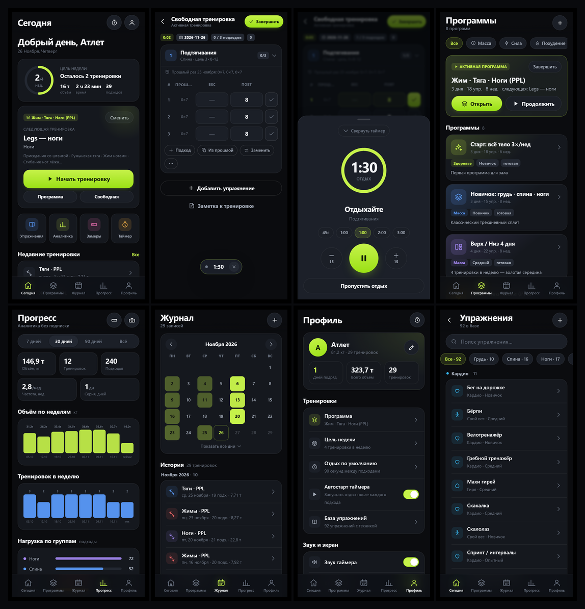

# Атлет — дневник тренировок

Бесплатное приложение для iPhone (PWA) вместо платных функций Fitness Online: программы, подходы, вес и повторения, таймер отдыха, замена упражнений, аналитика, замеры и фото прогресса. Без подписок, рекламы и регистрации. Данные хранятся только на телефоне.



## Публичная ссылка (работает без компьютера и без Wi-Fi)

**https://albtitov-gif.github.io/atlet/**

1. Откройте ссылку в Safari на iPhone.
2. «Поделиться» → «На экран Домой» → «Добавить».
3. Готово: иконка работает офлайн, данные хранятся на телефоне.

Приложение размещено на GitHub Pages (репозиторий `AlBTitov-gif/atlet`). Чтобы обновить версию — загрузите изменённые файлы в репозиторий, Pages пересоберётся автоматически.

> Если раньше пользовались версией по локальному адресу — это другой адрес сайта, данные у них раздельные. Перенесите историю через «Экспорт резервной копии» в старой версии и «Импорт из файла» в новой.

## Локальный сервер (запасной вариант)


### Вариант 1 — локальный сервер (рекомендуется, работает офлайн после установки)

1. Сервер уже настроен на автозапуск при входе в Windows (задача «Atlet Fitness Server»).
   Проверить или перезапустить: дважды щёлкните `ЗАПУСТИТЬ.bat` — откроется браузер, адрес появится в окне.
   Если Windows спросит про доступ в сеть — нажмите «Разрешить» (нужен порт 8123).
2. iPhone и компьютер должны быть в одной Wi-Fi сети.
3. На iPhone откройте Safari и введите адрес, который показан в окне, например:
   `http://192.168.76.172:8123/`
4. Safari → «Поделиться» → «На экран Домой» → «Добавить».

После этого приложение открывается с иконки, как обычное, работает без интернета и сохраняет данные локально.

> Если адрес не открывается с телефона: разрешите порт 8123 в брандмауэре Windows.
> Команда в PowerShell от имени администратора:
> `New-NetFirewallRule -DisplayName "Atlet Fitness 8123" -Direction Inbound -Protocol TCP -LocalPort 8123 -Action Allow -Profile Private`
> Компьютер должен быть включён и в той же Wi-Fi сети, что и iPhone.

### Вариант 2 — один файл `atlet.html` (без сервера)

Файл `atlet.html` (≈300 КБ) содержит всё приложение целиком.

1. Скопируйте его на iPhone через Яндекс.Диск, Telegram или «Файлы».
2. Откройте в Safari (или через приложение «Файлы»).
3. Добавьте на экран Домой через «Поделиться».

Работает офлайн. Учтите: в некоторых случаях iOS ограничивает сохранение данных для локальных файлов — для постоянного ведения истории надёжнее вариант 1.

Пересобрать файл после правок: `node build-standalone.mjs`

## Что было платным в Fitness Online — здесь бесплатно

| Платная функция | Реализация в «Атлете» |
|---|---|
| Таймер отдыха между подходами | Полноценный таймер: звук, вибрация, уведомление при заблокированном экране, пауза, +/−15 с, настройка 45–300 с |
| Замена упражнения на альтернативу | Замены для каждого упражнения + поиск по всей базе |
| Копирование/повтор тренировок | «Повторить» из журнала, «Из прошлой» для отдельных упражнений |
| Готовые программы и конструктор | 10 программ + создание и редактирование своих |
| Аналитика и графики | Объём по неделям, частота, нагрузка по группам, топ упражнений, рекорды 1ПМ |
| Замеры тела и фото прогресса | 9 показателей, график веса, галерея фото (хранится на устройстве) |
| Поиск и свои упражнения | Поиск, фильтр по группам, создание своих |

## Что внутри

| Раздел | Возможности |
|---|---|
| Сегодня | цель недели, старт по программе, свободная тренировка, серия дней, быстрые действия |
| Тренировка | подходы/вес/повторы, подсказки из прошлого раза, таймер отдыха (фон, звук, вибрация, уведомление), замена упражнения, заметки, дата тренировки (можно записать прошедшую) |
| Программы | 10 готовых программ (старт, сплит, верх/низ, PPL, 5×5, ягодицы, верх тела, жиросжигание, «Грудь + бицепс», «Спина + трицепс») + конструктор своих |
| Упражнения | 92 упражнения с техникой, группой мышц, оборудованием и заменами + свои упражнения и поиск |
| Журнал | календарь, история по месяцам, детали (объём, подходы, группы мышц), повтор тренировки, «поделиться» |
| Прогресс | объём по неделям, частота, нагрузка по группам, топ упражнений, рекорды 1ПМ, замеры, фото |
| Профиль | цель недели, отдых по умолчанию, звук/вибрация/уведомления, тёмная и светлая тема, экспорт/импорт JSON, демо-данные |


## Автозапуск сервера

Сервер на порту 8123 запускается при входе в Windows (задача «Atlet Fitness Server» в Планировщике заданий) и работает фоном, без окна.

- Перезапустить: `schtasks /run /tn "Atlet Fitness Server"`
- Остановить: `schtasks /end /tn "Atlet Fitness Server"`
- Удалить автозапуск: `schtasks /delete /tn "Atlet Fitness Server" /f`
- Лог запросов: `atlet-server.log`

## Технически

- Чистый HTML/CSS/JS без зависимостей и сборщиков (нативный ES-модули).
- Хранение — `localStorage` (ключ `atlet.state.v1`) + суточная резервная копия.
- Service worker (`sw.js`) кэширует приложение для офлайна.
- Таймер считает по абсолютному времени — не сбивается при блокировке экрана; Wake Lock не даёт экрану гаснуть.
- Формула 1ПМ — Эпли: `вес × (1 + повторы / 30)`.

Структура:

```
index.html            каркас
css/                  стили (app, components, session, library, programs, journal, progress)
js/main.js            роутер и обработчики действий
js/store.js           хранилище и миграции
js/exercises.js       база упражнений
js/templates.js        готовые программы
js/analytics.js       объём, история, рекорды, графики
js/session.js         активная тренировка
js/timer.js           таймер отдыха, звук, wake lock
js/views/             экраны
sw.js                 офлайн-кэш
server.py             локальный сервер (автозапуск через планировщик)
ЗАПУСТИТЬ.bat         запуск/подсказка адреса
build-standalone.mjs  сборка atlet.html
```

## Важно

- Это самостоятельное приложение, вдохновлённое удобством Fitness Online; оно не связано с ним и не копирует его интерфейс.
- Приложение не заменяет тренера и врача.
- Делайте экспорт данных в профиле — так история не потеряется при смене телефона.

